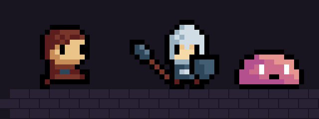
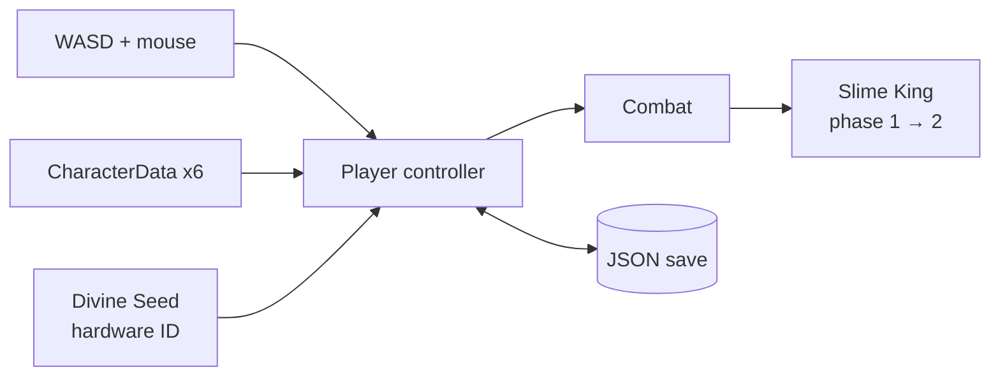

<div align="center">



# 👑 Dungeon King: Resurrection

### Fast top-down action RPG in Unity — six classes, a unique 'Divine Seed' soul skill and a two-phase Slime King

 

[](LICENSE)    

[](https://codespaces.new/shiroonigami23-ui/Dungeon-king?quickstart=1) [](https://github.com/shiroonigami23-ui/Dungeon-king/archive/refs/heads/main.zip)

[**Overview**](#-overview) · [**Features**](#-features) · [**Architecture**](#-architecture) · [**Getting Started**](#-getting-started) · [**Roadmap**](#-roadmap)

</div>

---

## 📖 Overview

**Dungeon King: Resurrection** is a fast-paced **top-down action RPG** built in Unity. Pick one of **six classes** (Warrior, Knight or Mage, each with male and female variants and unique passives), dash through dungeons with invincibility frames, shop with the blacksmith, and take on the **Slime King**, who **doubles in size and unleashes fireball novas** at half health. Every player receives a unique **Divine Seed** soul skill derived from their hardware ID, and progress persists via JSON saves.

### ✨ Highlights

- **6 classes** with passives
- **Divine Seed** — per-device unique soul skill
- **2-phase boss** with fireball novas
- **Procedural 8-bit sounds**

## 🧩 Features

| Feature | What it does |
|---|---|
| **Classes** | Warrior, Knight, Mage × 2 variants |
| **Combat** | Aim with mouse, attack, dash with i-frames |
| **Boss** | Slime King phase change at 50 % HP |
| **Economy** | Gold, armour and levelling; shop & NPCs |
| **Save/Load** | JSON persistence |
| **Audio** | Procedural retro sound system |

## 🛠 Tech Stack

| Layer | Technology |
|---|---|
| Engine | Unity 2022.3 LTS+ |
| Language | C# |
| Art | Pixel sprites |

## 🏗 Architecture




➡️ Full design notes, data flow and design decisions: **[docs/ARCHITECTURE.md](docs/ARCHITECTURE.md)**

## 📁 Project Structure

```text
Dungeon-king/
└── dungeon crawler/
    ├── Assets/   # scenes, scripts, sprites, CharacterData
    ├── Packages/
    └── ProjectSettings/
```

## 🚀 Getting Started

### 1. Get the code

Pick whichever method suits you:

| Method | Command |
|---|---|
| **HTTPS** | `git clone https://github.com/shiroonigami23-ui/Dungeon-king.git` |
| **SSH** | `git clone git@github.com:shiroonigami23-ui/Dungeon-king.git` |
| **GitHub CLI** | `gh repo clone shiroonigami23-ui/Dungeon-king` |
| **ZIP** | [Download](https://github.com/shiroonigami23-ui/Dungeon-king/archive/refs/heads/main.zip) and extract |
| **Codespaces** | [Open in browser](https://codespaces.new/shiroonigami23-ui/Dungeon-king?quickstart=1) — zero local setup, dev container preconfigured |

> 🔑 **Using SSH for the first time?** Generate a key with `ssh-keygen -t ed25519 -C "you@example.com"`, add the `.pub` contents at **GitHub → Settings → SSH and GPG keys**, then test with `ssh -T git@github.com`.

### 2. Install & set up

```bash
cd Dungeon-king
# open 'dungeon crawler' in Unity 2022.3 LTS+
```

### 3. Run

1. Build order: `MainMenu`, `DungeonLevel1`.
2. Assign the 6 `CharacterData` ScriptableObjects to the `Player` prefab.
3. Press **Play**.

| Action | Input |
|---|---|
| Move | WASD / Arrows |
| Aim | Mouse |
| Attack | Left click |
| Dash | Space |
| Interact | E |
| Pause | Esc |

## 🗺 Roadmap

**v1 (done)**

- [x] Classes, combat, Slime King, saves

**v1.1**

- [ ] More dungeon floors and enemies
- [ ] Loot rarity tiers
- [ ] Controller support

**v2.0**

- [ ] Procedural dungeon generation
- [ ] Co-op mode

➡️ Detailed plan, milestones and long-term vision: **[docs/ROADMAP.md](docs/ROADMAP.md)**

## 🤝 Contributing

Contributions, issues and feature requests are welcome!

1. Fork the repository
2. Create a feature branch: `git checkout -b feature/amazing-feature`
3. Commit your changes: `git commit -m "feat: add amazing feature"`
4. Push the branch: `git push origin feature/amazing-feature`
5. Open a Pull Request against `main`

Check the [issues page](https://github.com/shiroonigami23-ui/Dungeon-king/issues) and the [roadmap](docs/ROADMAP.md) for ideas on where to help.

## 📜 Changelog

See [CHANGELOG.md](CHANGELOG.md) for the release history.

## 📄 License

Distributed under the **MIT** license. See [LICENSE](LICENSE) for details.

## 👤 Author

**Aryan Singh Chandel** (Shiro)

[](https://github.com/shiroonigami23-ui)

<div align="center">

⭐ **If you find this project useful, consider giving it a star!** ⭐

</div>
