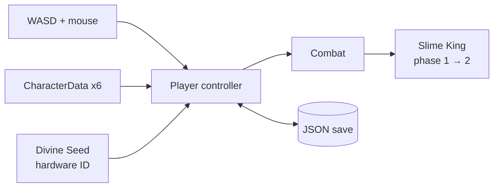

# 🏗 Architecture — Dungeon King: Resurrection

> Part of [Dungeon-king](https://github.com/shiroonigami23-ui/Dungeon-king). Back to the [README](../README.md).

## 1. System Overview

Character stats come from ScriptableObjects; the player controller handles movement, dash and attacks; the boss uses a phase state machine.

## 2. Components

| Component | Location | Responsibility |
|---|---|---|
| **Player** | `Assets/Scripts` | Movement, combat, passives |
| **Data** | `CharacterData assets` | Class stats |
| **Boss** | `Assets/Scripts` | Slime King phases |

## 3. Data / Control Flow

1. Choose class in MainMenu.
2. Fight through DungeonLevel1.
3. Defeat the Slime King.

## 4. Key Design Decisions

| Decision | Rationale |
|---|---|
| ScriptableObjects | Data-driven classes |

## 5. Known Limitations

- Single level currently

---
*Last updated: 2026-11-13*
